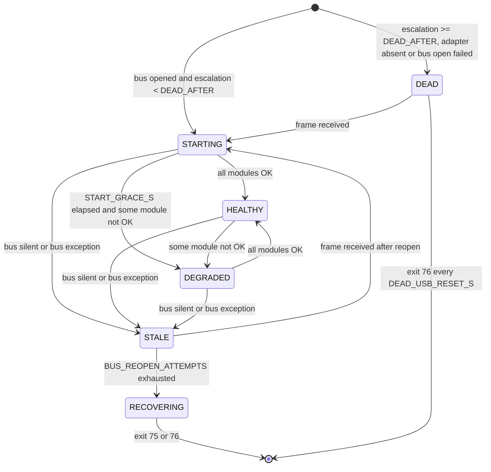

# 03 — Health and recovery (`HEALTH`)

This document defines how the service decides whether it is receiving good data, what it
polls and when, and what it does when the bus or the adapter stops working. The escalation
ends in one of the process exit codes in section 7. systemd and the root helpers in
`09-service.md` act on those codes.

Every timeout and threshold is an environment variable owned by `08-configuration.md`. This
document uses the variable names only.

Background: the SH-C31A adapter has been seen to stop receiving after transmitting sessions
until it is replugged (`../dyness-debug/docs/protocol.md`, "Observed on real hardware"). Bus
silence is therefore treated as an adapter fault that can need a link bounce or a USB reset.
A silent module is not treated as an adapter fault.

## 1. Clock and design constraints

* **HEALTH-01** All ages and timers MUST use a monotonic clock that is injected into the
  health machine as a `Callable[[], float]` (seconds). Wall-clock time MUST only be used for
  timestamps that get published or persisted.
* **HEALTH-02** The health machine MUST be a pure object with no I/O, sleeping, threads or
  reads of the real clock. Its inputs are the events in section 5.1 and the `now` passed to
  each call. Its only output is the list of actions (section 5.2) returned from `step(now)`.
  It MUST be unit-testable with a fake clock.
* **HEALTH-03** MQTT connection state MUST NOT be an input to the health machine. A broker
  outage MUST NOT change the health state, polling or exit behaviour.

## 2. Freshness

Ages are seconds since the last matching frame. Before a matching frame has arrived, an age
is measured from the time the bus was last opened successfully.

| Age | Source frames | Notes |
|---|---|---|
| `bus_age` | Any received frame whose class has "Bus activity" Yes in `01-protocol.md` §2 (PROTO-05): every non-error frame except `ECHO` (the poll pattern `0x18F21m77`, `01 00 …`). The heartbeat `0x18F20103` counts | Poll frames are excluded so that the adapter echoing our own transmits can never make a dead receive path look alive |
| `bcast_age(m)` | `0x16`, `0x21`, `0x22`, `0x23`, `0x24` from module `m` | The newest of these five |
| `cell_age(m)` | `0x11`, `0x12`, `0x13`, `0x14`, `0x15` from module `m` | The **oldest** of these five. All five have to be fresh. `0x17` is not used for freshness |

* **HEALTH-04** The service MUST compute `bus_age`, `bcast_age(m)` and `cell_age(m)` exactly
  as in the table above.
* **HEALTH-05** Each module `m` in 1..`MODULE_COUNT` MUST have exactly one status, checked
  in this order:

  | Status | Condition |
  |---|---|
  | `SILENT` | `bcast_age(m) > MODULE_STALE_S` |
  | `CELLS_STALE` | `cell_age(m) > CELL_STALE_S` and `CAN_LISTEN_ONLY` is false |
  | `OK` | otherwise |

* **HEALTH-06** When `CAN_LISTEN_ONLY` is true, stale cells MUST NOT make a module
  `CELLS_STALE`, because the service is not allowed to fix them by polling. Cell values are
  still published as `null` when stale (`04-telemetry.md`).
* **HEALTH-07** For `START_GRACE_S` after entering `STARTING`, a module that is not `OK` MUST
  NOT cause `DEGRADED`, availability `offline` or a re-poll. `STARTING` can still end early
  when every module is `OK` (section 4).

## 3. Poll policy

Polls are the only frames the service transmits (`01-protocol.md`, TX safety). The cell
stream keeps flowing after a poll, so a module that is `OK` is never polled again.

* **HEALTH-08** On entering `STARTING`, the machine MUST emit one `Poll(m)` for each module
  1..`MODULE_COUNT`, spaced `POLL_STAGGER_S` apart starting at the entry time. It MUST skip
  these polls when `CAN_LISTEN_ONLY` is true or polling is suspended.
* **HEALTH-09** For a module in `CELLS_STALE`, the machine MUST re-poll it every
  `POLL_RETRY_S` (measured from its last poll) for up to `POLL_MAX_RETRIES` polls, and then
  every `POLL_BACKOFF_S`. The retry count MUST reset to 0 when the module leaves
  `CELLS_STALE`.
* **HEALTH-10** For a module in `SILENT`, the machine MUST poll it every `POLL_BACKOFF_S`.
  The first such poll is sent `POLL_BACKOFF_S` after the module became `SILENT`.
* **HEALTH-11** The machine MUST NOT emit `Poll` for a module whose status is `OK`, in states
  `STALE`, `RECOVERING` or `DEAD`, while polling is suspended, or when `CAN_LISTEN_ONLY` is
  true.
* **HEALTH-12** Module-level faults (`CELLS_STALE`, `SILENT`) MUST NOT lead to a bus reopen,
  a link bounce, a USB reset or an exit. While `bus_age` is fresh the bus is demonstrably
  receiving, so `DEGRADED` MUST NOT escalate to bus recovery.

## 4. Stack health state machine



"Bus silent" means `bus_age > BUS_SILENCE_S`. "Bus exception" means an `on_bus_exception`
event (section 5.1).

State names are written in upper case as code identifiers; the published `health` value is
lower case per `06-mqtt.md` (MQTT-18), for example `STALE` → `stale` (HEALTH-29).

| State | Entered when | Actions on entry | Periodic actions | Exits |
|---|---|---|---|---|
| `STARTING` | At start-up when the bus opened and escalation < `DEAD_AFTER`; from `STALE` or `DEAD` when a frame arrives | Staggered polls (HEALTH-08). Grace timer starts | Due staggered polls. `SetAvailability(m, true)` as each module's broadcasts become fresh | All modules `OK` → `HEALTHY`. `START_GRACE_S` elapsed: all `OK` → `HEALTHY`, otherwise → `DEGRADED`. Bus silent or bus exception → `STALE` |
| `HEALTHY` | Every module `OK` and the bus fresh | Healthy timer starts | After `RECOVERY_RESET_S` continuously in `HEALTHY`, emit `SetEscalation(0)` once if escalation > 0 | Any module not `OK` → `DEGRADED`. Bus silent or bus exception → `STALE` |
| `DEGRADED` | Bus fresh, after the grace period, and at least one module not `OK` | `SetAvailability(m, false)` for each `SILENT` module | Poll ladders (HEALTH-09, HEALTH-10). Availability follows module status changes | All `OK` → `HEALTHY`. Bus silent or bus exception → `STALE`. **Never** → `RECOVERING` |
| `STALE` | From `STARTING`, `HEALTHY` or `DEGRADED` when the bus is silent or a bus exception occurs | `SetAvailability(m, false)` for every module. If `BUS_REOPEN_ATTEMPTS` ≥ 1, `ReopenBus` (attempt 1). Otherwise go straight to `RECOVERING` | When `BUS_SILENCE_S` has passed since the last attempt with no frame (or that attempt reported failure), and attempts < `BUS_REOPEN_ATTEMPTS`, `ReopenBus` again | Frame received → `STARTING`. All `BUS_REOPEN_ATTEMPTS` attempts used and `BUS_SILENCE_S` passed since the last one with no frame → `RECOVERING` |
| `RECOVERING` | From `STALE` (terminal) | `SetAvailability(m, false)` for every module, `SetEscalation(n + 1)`, then `Exit(75 if n = 0 else 76, reason)`, where `n` is the current escalation | None. The process is exiting | Process exit |
| `DEAD` | At start-up: escalation ≥ `DEAD_AFTER`, adapter absent, or bus open failed | `SetAvailability(m, false)` for every module. DEAD timer starts | `ReopenBus` every `DEAD_RETRY_S` while no frame arrives. `Exit(76, "dead_usb_reset")` once `DEAD_USB_RESET_S` has passed since entry | Any frame → `STARTING`. `DEAD_USB_RESET_S` reached → exit 76 |

* **HEALTH-13** The service MUST implement the states, entry conditions, actions and exits
  in the table above. No other transitions are permitted.
* **HEALTH-14** A `ReopenBus` attempt that fails to open the bus MUST count as a used attempt
  in `STALE` and as a retry in `DEAD`. The next attempt still waits for its normal interval.
* **HEALTH-15** `RECOVERING` MUST persist the incremented escalation counter (section 6)
  before the process exits. The exit in `DEAD` MUST NOT change the escalation counter.
* **HEALTH-16** The escalation counter MUST only be reset by `SetEscalation(0)` after
  `RECOVERY_RESET_S` of unbroken `HEALTHY`. Any other state restarts that timer.
* **HEALTH-17** After `ReopenBus` succeeds, the first received frame (as defined for
  `bus_age`) MUST move `STALE` or `DEAD` to `STARTING`. That transition re-polls every
  module (HEALTH-08).

### 4.1 Reasons

Each transition carries a reason string of the form `<code>` or `<code>: <detail>`. The
codes are fixed:

| Code | Used for |
|---|---|
| `start` | Entering `STARTING` at process start |
| `bus_resumed` | `STALE` or `DEAD` → `STARTING` |
| `all_ok` | → `HEALTHY` |
| `modules_not_ok` | → `DEGRADED`. Detail lists modules and statuses, for example `m2 cells_stale, m3 silent` |
| `bus_silent` | → `STALE` because `bus_age > BUS_SILENCE_S` |
| `bus_error` | → `STALE` because of a bus exception. Detail is the errno name or message |
| `reopen_exhausted` | → `RECOVERING` |
| `escalation_limit` | → `DEAD` because escalation ≥ `DEAD_AFTER` |
| `adapter_absent` | → `DEAD` because `CAN_CHANNEL` does not exist |
| `bus_open_failed` | → `DEAD` because opening the bus failed for any other reason |
| `dead_usb_reset` | Exit 76 from `DEAD` |
| `polling_suspended` | Diagnostic reason attached to `SuspendPolling` |

* **HEALTH-18** Every transition MUST carry a reason using one of the codes above.

## 5. Machine interface

### 5.1 Inputs

| Call | Meaning |
|---|---|
| `start(now, open_ok, detail)` | Called once, after the application has read the escalation counter and attempted the first bus open. `open_ok=false` with `detail` `adapter_absent` or another error |
| `on_frame(arbitration_id, now)` | A non-error frame was received whose class counts as bus activity (PROTO-05); `ECHO` frames are not reported |
| `on_error_frame(now)` | A CAN error frame was received |
| `on_bus_exception(now, detail)` | `recv` raised `OSError`, or `send` raised `OSError` other than `ENOBUFS`/`EAGAIN` (a full TX queue on an un-ACKed bus is not a bus fault) |
| `on_bus_open(now, ok, detail)` | The result of a `ReopenBus` action |
| `step(now) -> list[Action]` | Advance timers and return the actions due |

The application maps each `TransportFault(op, kind, …)` (`02-can-transport.md` §8) to an
input as follows. `detail` is `"<kind>: <message>"` unless stated otherwise.

| `op` | `kind` | Input |
|---|---|---|
| `open`, first open at start-up | `DEVICE_GONE` | `start(now, False, "adapter_absent")` |
| `open`, first open at start-up | any other (`LINK_DOWN`, `OS_ERROR`, `OPEN_FAILED`, `CAN_ERROR`, `LISTEN_ONLY_REFUSED`) | `start(now, False, detail)` (reason `bus_open_failed`) |
| `open`, from `ReopenBus` | any | `on_bus_open(now, False, detail)` |
| `send` | `TX_BLOCKED` | None. Logged at `WARNING`; not a bus fault. The retry ladder (HEALTH-09) re-polls if the cells stay stale |
| `recv` or `send` | `DEVICE_GONE`, `LINK_DOWN`, `OS_ERROR`, `CAN_ERROR`, `NOT_OPEN` | `on_bus_exception(now, detail)` |

The machine is constructed with the settings and the escalation counter value read at
start-up. After that, it is the only thing that changes the counter.

### 5.2 Actions

| Action | Application side effect |
|---|---|
| `Transition(old, new, reason)` | Log at `INFO`, publish service state (section 8), send `STATUS=` to systemd (`09-service.md`) |
| `Poll(module)` | Send the poll frame for `module` (`01-protocol.md`) |
| `SetAvailability(module, online)` | Publish module availability (section 8) |
| `ReopenBus` | Shut down the bus if open, wait 2 s, open it, then report `on_bus_open` |
| `SuspendPolling(reason)` | Log at `WARNING` and publish the diagnostic. Has no effect on state |
| `SetEscalation(value)` | Atomically write the escalation counter (section 6) |
| `Exit(code, reason)` | Publish service state, run the clean-stop sequence (`09-service.md`) and exit with `code` |

* **HEALTH-19** The machine MUST expose exactly the inputs in 5.1 and emit only the actions
  in 5.2. `step` MUST return actions in a deterministic order: `Transition` first, then
  `SetAvailability`, `SetEscalation`, `SuspendPolling`, `Poll`, `ReopenBus`, `Exit`.
* **HEALTH-20** The machine MUST also expose read-only access to the current state, the last
  reason and each module's status and ages, for publishing. Module status is the enum
  `ModuleStatus` with exactly the members `OK`, `CELLS_STALE` and `SILENT` (HEALTH-05); it is
  the `status` mapping passed to the telemetry `snapshot(now, status)` (`04-telemetry.md`
  TEL-03). `bcast_age(m)` and `cell_age(m)` are published as `bcast_age_s` and `cell_age_s`
  (TEL-07), which are `None` until a frame of that group has arrived rather than measured
  from the bus open time.
* **HEALTH-21** The application MUST carry out the actions in the order returned. `ReopenBus`
  is the only action allowed to block (up to the 2 s wait plus the open call).

## 6. Error frames and the escalation file

* **HEALTH-22** Error frames MUST NOT update `bus_age` and MUST NOT by themselves cause a
  state change, a reopen or an exit. Bus-off is handled by the kernel's automatic restart
  (`CAN_RESTART_MS`, applied by `can-up`).
* **HEALTH-23** The machine MUST count error frames in a sliding window of `ERROR_WINDOW_S`.
  When the count reaches `ERROR_SUSPEND_COUNT`, it MUST emit `SuspendPolling` once. Polling
  then stays suspended for the life of the process. A restart clears the suspension.
* **HEALTH-24** The escalation state MUST be stored in `recovery.json` in the directory named
  by `$STATE_DIRECTORY` (set by systemd's `StateDirectory=`, see `09-service.md`). It holds a
  single JSON object:

  ```json
  {"escalation": 0, "restarts": 0, "updated": "2026-10-09T12:00:00Z"}
  ```

  `escalation` is the counter used by this document. `restarts` is incremented by the
  application at each start-up when `last_exit.json` (written by `recover`, see
  `09-service.md`) exists and its `code` is not `0`. It is published as a diagnostic.
  `updated` is the UTC ISO 8601 time of the last write.
* **HEALTH-25** Writes to `recovery.json` MUST be atomic: write a temporary file in the same
  directory, `fsync` it, then rename it over the original. A missing, unreadable or invalid
  file MUST be treated as `{"escalation": 0, "restarts": 0}` and logged at `WARNING`. It MUST
  NOT stop the service from starting.
* **HEALTH-26** When `$STATE_DIRECTORY` is unset (development runs), the counter MUST be kept
  in memory only, start at 0, and a `WARNING` MUST be logged once.

## 7. Exit codes

| Code | Meaning | Who exits | What follows |
|---|---|---|---|
| `0` | Clean stop on `SIGTERM`, `SIGINT` or `SIGHUP` | Signal handling (`09-service.md`) | After `systemctl stop`: nothing. After a signal from anywhere else: `Restart=always` restarts it after `RestartSec`. `recover` only records `last_exit` |
| `1` | Unhandled exception (crash) | Top-level handler | Restart after `RestartSec`. `recover` only records `last_exit` |
| `75` | Link bounce requested (`EX_TEMPFAIL`) | `RECOVERING` with escalation 0 | `recover` takes the link down and runs `can-up`, then systemd restarts the service |
| `76` | USB reset requested (`EX_PROTOCOL`) | `RECOVERING` with escalation ≥ 1, or `DEAD` every `DEAD_USB_RESET_S` | `recover` runs the USB reset sequence and `can-up`, then systemd restarts the service |
| `78` | Configuration error (`EX_CONFIG`) | `08-configuration.md` CFG-03 | `RestartPreventExitStatus=78`: no restart, the unit is left `failed` |

A systemd watchdog timeout is not an exit code. systemd kills the process with `SIGABRT`
(`SERVICE_RESULT=watchdog`), `recover` only records it, and `Restart=always` restarts the
service.

* **HEALTH-27** The process MUST exit only with the codes in the table above. Codes 75 and 76
  MUST be produced only by the `Exit` action.
* **HEALTH-28** An unhandled exception MUST be logged with its traceback at `ERROR`. The
  service MUST then try a bus shutdown and exit with status 1.

## 8. What is published

* **HEALTH-29** On every `Transition`, the application MUST immediately publish
  `<MQTT_BASE_TOPIC>/service/state` with at least the fields `health` (the new state as a
  lowercase enum value: `starting`, `healthy`, `degraded`, `stale`, `recovering`, `dead`)
  and `health_reason` (the reason string). The exact payload keys and their placement are
  owned by `06-mqtt.md`.
* **HEALTH-30** On every `SetAvailability`, the application MUST immediately publish
  `online` or `offline` to `<MQTT_BASE_TOPIC>/module/<m>/availability` (format owned by
  `06-mqtt.md`). A module is `online` exactly when its status is `OK` or `CELLS_STALE` and
  the state is `STARTING`, `HEALTHY` or `DEGRADED`.
* **HEALTH-31** Before an `Exit`, the application MUST publish the service state with the
  final `health` and `health_reason` before it disconnects from the broker. This publish is
  best effort and MUST NOT delay the exit by more than 2 s.

## 9. Watchdog interaction

* **HEALTH-32** The systemd watchdog MUST only be pinged from the main loop, once per
  completed iteration that has run receive, health step and publish (cadence in
  `09-service.md`). A hung main loop therefore stops the pings and systemd restarts the
  service.
* **HEALTH-33** The main loop's `recv` MUST use the bounded timeout defined in
  `02-can-transport.md`, so a silent bus never blocks an iteration. The health machine never
  blocks (HEALTH-02).
* **HEALTH-34** No action other than `ReopenBus` (HEALTH-21) and the shutdown publish
  (HEALTH-31) may block the main loop for more than 1 s.
