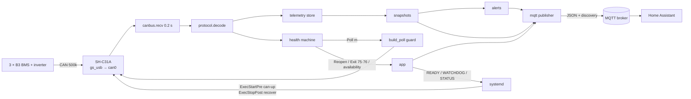

# dyness-b3-bms-mqtt — initial design

* **Date:** 2026-10-09
* **Status:** accepted; initial design
* **Scope:** the whole service as first specified in `docs/specs/`

This is the decision record for the first version of the service. It is not edited after the
fact: later changes get their own dated design documents in this directory, and the living
specs in `docs/specs/` are updated alongside them (`docs/specs/00-overview.md` §4.5).

## 1. Context

[dyness-debug](https://github.com/gsdevme/dyness-debug) diagnosed a 3 × Dyness B3 stack on a
Solis RHI-3.6K-48ES-5G whose SOC collapsed suddenly and which delivered well under its rated
capacity. Using a DSD TECH SH-C31A USB-CAN adapter on a Mac it worked out the BMS monitoring
protocol, confirmed it on the real stack on 8–9 October 2026, and found the cause: one weak,
high-resistance cell in each of two modules, **module 2 cell 8** and **module 3 cell 9**.
Those cells reach the 3.50 V and low cut-off points early, so their modules re-zero their SOC
and drag the stack SOC and current limits with them.

The evidence went to Dyness, but the cells are still in service. Whether they get worse,
and how the stack behaves day to day, needs continuous watching rather than one-off captures.
The dyness-debug `SPEC.md` "Later" roadmap already named the next step: publish per-cell
sensors, spread, min/max and alarms to MQTT for Home Assistant using discovery, on an
always-on host near the batteries, with alerting on spread > 50 mV, any cell < 3.0 V and
module current imbalance > 20 %. This project is that step.

Facts carried over from dyness-debug that shape the design:

* The bus is CAN 2.0B at 500 kbit/s on RJ45 pins 4/5. RS485 is silent with the Solis DIP
  setting.
* Modules broadcast summary frames (`0x16`, `0x21`–`0x24`) unprompted at about 1.7 Hz. The
  per-cell stream (`0x11`–`0x15`, `0x17`) only starts after a poll `0x18F21m77`, and then
  continued all night without further polls.
* The inverter frames (`0x351`, `0x355`, `0x356`, `0x359`, …) and every module are visible
  from the spare OUT port of the last slave.
* On macOS userspace `gs_usb`, the SH-C31A stopped receiving after a transmitting session
  until it was replugged. Whether the Linux kernel driver has the same problem is unknown.

## 2. Goals and non-goals

Goals:

1. Every module, stack and service value is visible in Home Assistant with no manual YAML.
2. The weak cells and the stack's balance are alerted on inside the service, not only in HA.
3. The service always runs: it survives adapter unplugs, link failures, broker outages and
   Home Assistant restarts unattended, and says what state it is in.
4. Installation on a stock Raspberry Pi OS image is one `make install`.
5. Behaviour is specified first and every `MUST` is traceable to a test.

Non-goals: transmitting anything except the poll frame; writing BMS parameters
(`0x18F26677`); RS485; controlling the inverter; a web UI; long-term storage (Home Assistant
recorder or InfluxDB do that); shipping any Dyness binaries, manuals or parameter files.

## 3. Constraints

| Constraint | Consequence |
|---|---|
| Raspberry Pi Zero 2 W, 512 MB RAM, quad A53 | One process, small dependency set, no asyncio framework or web server; budget CPU < 5 %, RSS < 60 MB (`11-testing.md`) |
| SH-C31A RX-stall quirk after transmitting (seen on macOS) | Transmit as little as possible (one poll per module, re-poll only on stale cells), always `bus.shutdown()` cleanly, and have a USB-reset rung on the recovery ladder |
| Raspberry Pi OS Bookworm ships systemd 252 | No `RestartSteps=`/`RestartMaxDelaySec=` (254+); back-off has to come from the service's own escalation logic and a fixed `RestartSec=` |
| Pi OS uses NetworkManager | `systemd-networkd` is not running and enabling it brings `wait-online` delays |
| Zero 2 USB is an OTG port without per-port power switching | A true VBUS power cycle of the adapter is impossible; the strongest reset available is a USB-level reset or deauthorise/reauthorise |
| The bus is shared with the inverter's closed loop | Any unexpected transmit risks the inverter; TX must be guarded in code and tested |

## 4. Architecture

One synchronous Python 3.14 process (package `dyness_b3_bms_mqtt`), managed by `uv` and run
by systemd as `Type=notify` with a watchdog. Modules: `config`, `protocol` (pure decode and
the guarded `build_poll`), `telemetry` (latest values with monotonic timestamps → snapshots),
`alerts` (pure), `health` (pure state machine that returns actions), `canbus` (python-can
wrapper), `discovery` (pure payload builder), `mqtt` (publisher protocol and paho-mqtt 2.x
implementation), `sdnotify` (no dependency) and `app` (wiring, signals, exit codes). A
monotonic clock is injected everywhere so all timing logic is testable without sleeping.

Main loop: `recv(timeout=0.2)` → decode → store and health → execute health actions → handle
MQTT events (connected, HA `online`) → periodic publish → watchdog ping. The paho network
thread only sets events; it never touches state.

Recovery is a ladder split between the process and two root helpers: in-process bus reopen,
then exit 75 (the `recover` helper bounces the link), then exit 76 (the helper resets the USB
device), then DEAD mode (stay up, publish diagnostics, retry slowly, request a USB reset
periodically). An escalation counter in the systemd `StateDirectory` survives restarts and is
reset after a sustained healthy period.

## 5. Decisions

| # | Decision | Rejected alternatives and why |
|---|---|---|
| D1 | **Synchronous single main loop**; paho runs its own thread that only sets `threading.Event`s | *asyncio*: python-can's API is synchronous, traffic is under 100 frames/s, and the asyncio wrappers add a thread anyway. A single loop also means a watchdog ping proves the real work is progressing |
| D2 | **One flat JSON payload per device** (`module/<m>/state`, `stack/state`, `service/state`) with `value_template` per entity | *One topic per sensor*: 3 × ~40 values would mean ~150 publishes per interval on a Zero 2, and values from one instant could arrive torn. Flat JSON keeps one consistent snapshot per message |
| D3 | **Device-based discovery** (`homeassistant/device/<node>_m<m>/config`, HA ≥ 2024.11) | *Per-entity discovery*: ~150 retained config topics to publish, republish and clean up. One config per device is atomic and easier to remove |
| D4 | **Root helpers via `ExecStartPre=+`/`ExecStopPost=+`**; the service itself runs as `DynamicUser` with no privileges | *`CAP_NET_ADMIN` on the service*: it would let the long-running Python process reconfigure networking and write sysfs. *polkit/sudo rules*: more moving parts and still privileged calls from the process. The helpers are short, idempotent and act only on exit codes |
| D5 | **udev rule + `ExecStartPre` running `can-up`** to configure `can0` | *systemd-networkd `.network` file*: not running on Pi OS (NetworkManager), and enabling it pulls in `wait-online` boot delays. *NetworkManager*: no SocketCAN support. udev covers hotplug, `ExecStartPre` covers every service start |
| D6 | **USB reset order: `USBDEVFS_RESET` ioctl → `authorized` 0/1 → driver unbind/bind**, then wait for the netdev and run `can-up`; done only by the root helper on exit 76 | *In-process reset*: needs root. *VBUS power cycle*: impossible on the Zero 2 OTG port without an external switchable hub. *Unbind/bind first*: weaker than a bus-level reset for a wedged firmware |
| D7 | **Kernel `gs_usb` → SocketCAN `can0`** with python-can `socketcan`; `CAN_INTERFACE` allows `gs_usb`, `slcan`, `virtual` for development and tests | *Userspace `gs_usb` via libusb on Linux*: needs USB permissions, loses kernel filters, bus-off restart and `ip` statistics, and is the path that showed the RX stall on macOS |
| D8 | **Normal (transmitting) mode by default**, `CAN_LISTEN_ONLY` available; first hardware run uses listen-only | *Listen-only by default*: the 15 cell values, which are the point of the project, only stream after a poll. The RX-stall risk is handled by the recovery ladder instead |
| D9 | **Configuration errors exit 78 with `RestartPreventExitStatus=78`**; every other exit restarts forever (`StartLimitIntervalSec=0`) | *Restart on everything*: a bad environment file cannot heal itself, and a restart loop only fills the journal and hides the message. *Fail on start-limit*: contradicts "always runs" for transient faults |
| D10 | **Per-module min/max/spread from broadcast `0x22`**; polled cells feed the 15 cell sensors and the stack lowest/highest with module and cell number | *Compute spread from polled cells only*: spread and the spread alert would vanish whenever the cell stream is stale or listen-only is set. `0x22` is unsolicited and always available |
| D11 | **Environment file only** (`/etc/default/dyness-b3-bms-mqtt`, `EnvironmentFile=`) | *TOML/YAML config file*: a parser, a schema and a second place for settings, for a flat list of ~45 values that systemd already knows how to load |
| D12 | **Published current is positive when charging**, for modules and stack | *Keep the raw module sign* (negative = charging on `0x21`): the inverter's `0x356` uses positive = charging, so raw values would disagree within one device page. Home Assistant battery cards also expect positive = charging |
| D13 | Poll each module once at start, re-poll only when its cell stream is stale, with a retry then back-off ladder | *Poll continuously like Dyness Monitor*: more transmissions on a shared bus and more exposure to the RX-stall quirk, for no extra data since the stream persists |
| D14 | Error frames only suspend polling for the process lifetime; they never cause an exit | *Treat error frames as a bus fault*: the kernel's `restart-ms` already handles bus-off, and exiting on noise would cycle the adapter for no reason |

## 6. Fault model

| Fault | Detection | Response | Visible in Home Assistant |
|---|---|---|---|
| One module stops broadcasting | Module broadcast age > `MODULE_STALE_S` | Module SILENT; health DEGRADED; poll at back-off interval; no bus recovery | Module device unavailable; service health `degraded` |
| Cell stream stops for a module | Cell age > `CELL_STALE_S` | Re-poll `POLL_MAX_RETRIES` times at `POLL_RETRY_S`, then every `POLL_BACKOFF_S` | Cell sensors unknown; module stays available; health `degraded` |
| Whole bus silent (cable, adapter RX stall) | No frame for `BUS_SILENCE_S` | STALE: shutdown, reopen, re-poll, up to `BUS_REOPEN_ATTEMPTS`; then exit 75, then 76 on the next escalation | All modules unavailable; health `stale` then `recovering` with reason |
| Adapter unplugged | `OSError` ENODEV / interface absent | As above; after restart, DEAD while absent; udev `can-up` on replug | Modules unavailable; health `dead` with reason; CAN state `absent` |
| Link administratively down | `OSError` ENETDOWN | Reopen fails; exit 75; `recover` bounces the link | As above, briefly `recovering` |
| Bus-off / error storm | Error frames; bus state from `ip -j -d -s link show` | Kernel `restart-ms` restarts the controller; reaching `ERROR_SUSPEND_COUNT` in `ERROR_WINDOW_S` suspends polling | CAN state, error frame and bus-off restart counters; polling-suspended diagnostic |
| Repeated failures | Escalation counter ≥ `DEAD_AFTER` | DEAD mode: stay up, reopen every `DEAD_RETRY_S`, exit 76 every `DEAD_USB_RESET_S` | Health `dead`; service restart count and last exit |
| MQTT broker down | paho disconnect | Keep reading CAN; reconnect with back-off; publish latest snapshot on reconnect, no backlog | Everything unavailable via the broker's LWT (`status` = `offline`) |
| Home Assistant restart | `homeassistant/status` = `online` | Republish discovery, availability and state after a random 0–5 s delay | Entities return without intervention |
| Main loop hung | systemd watchdog not fed | systemd kills and restarts the process | LWT `offline`, then back online; restart count increments |
| Invalid configuration | Validation at start-up | Log every bad variable, exit 78, no restart | Nothing published; `systemctl status` shows status 78 |
| Weak cell worsens | Cell below `ALERT_CELL_LOW_MV` or spread above `ALERT_CELL_SPREAD_MV`, debounced | Alert binary_sensor on, with hysteresis | Problem binary_sensor on the module and stack |

## 7. Risks and unknowns

| Risk / unknown | Mitigation |
|---|---|
| The RX stall after transmitting may also happen with the Linux kernel driver | Minimal transmissions; clean shutdown; recovery ladder with link bounce and USB reset; acceptance step checks RX an hour after polling |
| How long the cell stream persists unpolled is only known for one night | Cell staleness is detected per module and triggers a bounded re-poll ladder |
| Base of the `0x23` temperature sensor number (0..2 seen) is not confirmed | Tagged **UNVERIFIED** in `01-protocol.md`; checked in hardware acceptance step 1 |
| Whether long-term polling disturbs the inverter's closed loop | Poll at start and only on stale cells; acceptance step 2 watches the inverter limits; listen-only remains available |
| Pi Zero 2 memory and CPU headroom with paho, python-can and Python 3.14 | Performance budget and 24 h soak in `11-testing.md` |
| Device-based discovery needs HA ≥ 2024.11 | Stated as a requirement of the target system in `00-overview.md` |

## 8. Hardware rollout plan

1. Bench: full test suite on the virtual bus, then install on the Pi with the adapter
   unplugged to check DEAD mode and diagnostics.
2. Connect to the last slave's spare OUT, `CAN_LISTEN_ONLY=true`. Confirm every module and
   inverter frame, check the **UNVERIFIED** facts, leave for a day.
3. Enable polling. Watch cells populate, the inverter limits, and that reception continues.
4. Fault injection: the hardware acceptance checklist in `11-testing.md` (unplug, link down,
   broker stop, HA restart, watchdog, bad config, power cycle).
5. 24 h soak with resource checks, then leave running unattended.

Results are recorded as described in `11-testing.md`; anything that contradicts the specs is
changed in the specs and, if it changes a decision above, in a new dated design document.

## 9. Spec files

| File | Prefix | Covers |
|---|---|---|
| `docs/specs/00-overview.md` | — | Scope, target system, glossary, conventions, traceability |
| `docs/specs/01-protocol.md` | PROTO | Frame IDs, layouts, scaling, the poll frame, TX safety |
| `docs/specs/02-can-transport.md` | CAN | Opening the bus, interfaces, filters, error frames, shutdown, bus state |
| `docs/specs/03-health-and-recovery.md` | HEALTH | Freshness, health state machine, poll policy, recovery ladder, exit codes |
| `docs/specs/04-telemetry.md` | TEL | Snapshot model, derived values, units, sign, staleness |
| `docs/specs/05-alerts.md` | ALERT | Alert definitions, thresholds, debounce, hysteresis |
| `docs/specs/06-mqtt.md` | MQTT | Broker connection, topics, payloads, QoS/retain, reconnect |
| `docs/specs/07-home-assistant.md` | HA | Discovery devices and entities, availability, republish |
| `docs/specs/08-configuration.md` | CFG | Every environment variable, defaults, validation |
| `docs/specs/09-service.md` | SVC | systemd unit, watchdog, root helpers, udev, USB reset |
| `docs/specs/10-installation.md` | INST | Makefile, paths, uv and Python 3.14 |
| `docs/specs/11-testing.md` | TEST | Simulator, fakes, traceability, CI, hardware acceptance |
